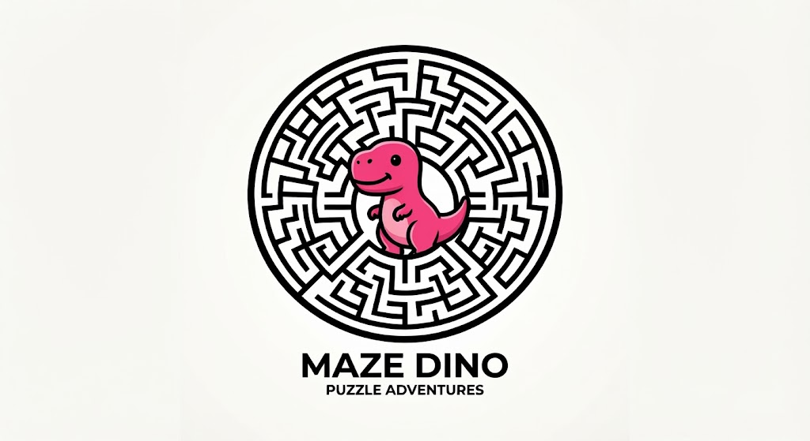
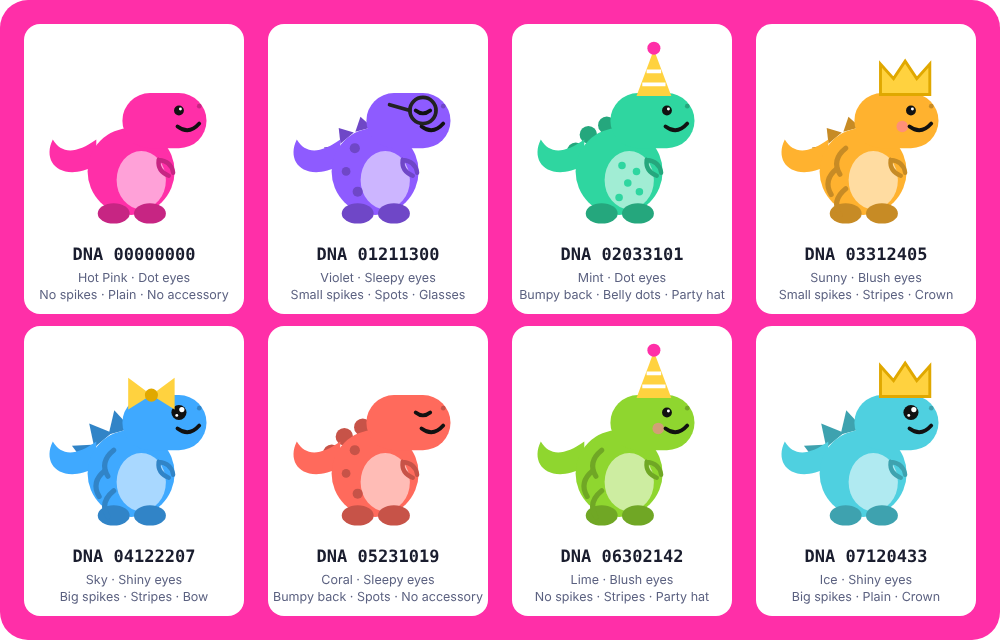

# MAZE DINO

A small browser maze game starring a pink dino, built as a playful demo for the **MAZE ($MAZE)** ERC-20 token. Guide the dino to the star, level after level. The game is free to play. Connecting a wallet is optional: it shows your MAZE balance and lets you send the creator a tip.

## Play

Open `index.html` in a browser, or publish the repo with GitHub Pages (Settings, Pages, deploy from the main branch).

Controls: arrow keys, WASD, swipe, or the on-screen buttons.

## The token

| | |
|---|---|
| Name / symbol | MAZE / $MAZE |
| Standard | ERC-20 (burnable), Ethereum mainnet |
| Contract | [`0x2F4f8d5094298BD4ddd774011bd0917052f4d1d2`](https://etherscan.io/token/0x2F4f8d5094298BD4ddd774011bd0917052f4d1d2) |
| Decimals | 18 |

The wallet panel talks to your wallet directly (no libraries, no server). Nothing is sent unless you confirm it in your wallet. To enable tips, set `TIP_ADDRESS` at the top of the script in `index.html`.

## Roadmap

- **Version 1 (this repo):** playable maze, wallet connect, MAZE balance, optional tips.
- **Version 2:** a small reward pool contract funded with MAZE. Finishing a level lets a player claim a small reward, with finishes verified so bots cannot drain the pool.
- **Version 3:** collectible dinos whose look comes from a DNA number (below). A draft contract is in [`contracts/`](contracts/); it is untested on a live network and not deployed.

## Dino DNA (concept art)

Every dino is a number. An 8-digit DNA picks its look:

| Digits | Trait | Options |
|---|---|---|
| 1-2 | Body color | Hot Pink, Violet, Mint, Sunny, Sky, Coral, Lime, Ice |
| 3 | Eyes | Dot, Shiny, Sleepy, Blush |
| 4 | Back | No spikes, Small spikes, Big spikes, Bumpy back |
| 5 | Pattern | Plain, Spots, Stripes, Belly dots |
| 6 | Accessory | None, Party hat, Bow, Glasses, Crown |
| 7-8 | Reserved | Future traits |

Digits are mapped with a remainder (for example, color = first two digits mod 8), so any number gives a valid dino.

Regenerate the sheet with `python3 tools/make_variations.py` (needs Python and Playwright with Chromium).

## Notes

Maze Dino is an early-stage hobby project. MAZE has small liquidity, and nothing here is financial advice or a promise of value. Always check the contract address above before trading.

## How it works (for young programmers)
The whole game is one file, `index.html`, made of HTML, CSS and JavaScript. You can open it in a browser and change it.

- **Making a maze.** `makeMaze(n)` builds an n by n grid and carves paths with a "walk and backtrack" method: start in a corner, move to a random cell you haven't visited, and when you get stuck, step back until you find a new way. Every cell ends up connected, so there is always a path to the star.
- **Walls.** Each cell stores which sides are open as numbers: up = 1, right = 2, down = 4, left = 8. Add them together to describe a cell.
- **Moving.** Arrow keys, WASD, swipes and the on-screen buttons all call the same `move()` function, which only lets the dino pass through open sides.
- **Levels.** Each level makes the grid a little bigger (`6 + level * 2`, up to 24).

Try it: change the 6 or the 24 in `newLevel()`, or change the colors at the top of the file, and reload the page.

## Kids mode
Add `?kids=1` to the URL (https://aiontrust.github.io/maze-dino/?kids=1) to hide the wallet and tip section so young players only see the maze.
